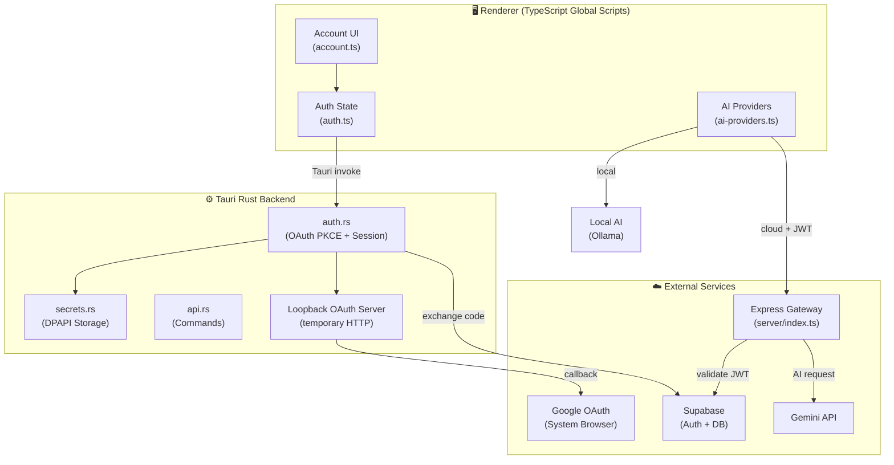
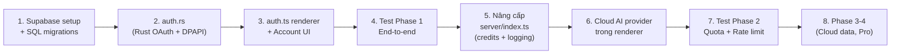

# Kế Hoạch Chi Tiết: Google Auth, Account Management & AI Cloud System
## EduGame Studio — Tauri Desktop App

> [!IMPORTANT]
> Đây là kế hoạch **KHÔNG CODE**. Toàn bộ implementation được phân tích dựa trên kiến trúc thực tế của dự án.
> Không rewrite project. Không migrate sang Electron. Không phá vỡ local AI / local storage / gameplay hiện tại.

---

## Mục Lục

1. [Phân Tích Kiến Trúc Hiện Tại](#1-phân-tích-kiến-trúc-hiện-tại)
2. [Tổng Quan Hệ Thống Mới](#2-tổng-quan-hệ-thống-mới)
3. [Phase 1 — Supabase + Google OAuth + Account UI + Session](#3-phase-1)
4. [Phase 2 — Cloud AI Gateway + JWT + Quota + Rate Limiting](#4-phase-2)
5. [Phase 3 — Cloud Data Preparation](#5-phase-3)
6. [Phase 4 — Pro Subscription Infrastructure](#6-phase-4)
7. [SQL Migrations Chi Tiết](#7-sql-migrations-chi-tiết)
8. [Tauri Security Review](#8-tauri-security-review)
9. [Testing Plan](#9-testing-plan)
10. [Rủi Ro & Giảm Thiểu](#10-rủi-ro--giảm-thiểu)

---

## 1. Phân Tích Kiến Trúc Hiện Tại

### 1.1 Stack Tổng Quan

| Layer | Công Nghệ | Ghi Chú |
|-------|-----------|---------|
| Desktop shell | Tauri v2 | Rust backend + WebView2 |
| Renderer | TypeScript global scripts | Không phải ES modules |
| Backend gateway | Node.js Express (`server/index.ts`) | Đã có, chạy riêng |
| Database cục bộ | SQLite (via `better-sqlite3`) | Offline, DPAPI key |
| AI cục bộ | Ollama / local providers | Primary AI path |
| Secrets | Rust `secrets.rs` (DPAPI) | Windows Credential Store |
| Load order | `src/index.html` xác định thứ tự | Quan trọng cho global scripts |

### 1.2 Những Gì Đã Có

#### `server/index.ts` — Gateway đã tồn tại
- Express server với Supabase admin client
- JWT validation từ Authorization header
- Gọi Gemini API (server-side, không lộ key ra client)
- RPC gọi `consume_generation_quota` trong database
- Xử lý lỗi quota và trả response

#### `server/schema.sql` — Schema đã có
```
subscriptions (user_id, plan: free|plus, status, updated_at)
usage_monthly (user_id, month, generations_used, generations_limit)
consume_generation_quota() — PostgreSQL function
```

> [!WARNING]
> Schema hiện tại dùng `generations` (đếm lượt), **không phải** credits-based.
> Quota hiện tại: Free=5, Plus=100 — **quá thấp** so với spec mới (50/500 credits).
> Cần migration, không rewrite từ đầu.

#### Những Gì **Chưa** Có
- `profiles` table
- `ai_usage_log` table
- Google OAuth flow (bất kỳ đâu)
- Session persistence an toàn cho desktop
- Cloud AI provider trong `src/services/ai/ai-providers.ts`
- Account UI (page, component)
- Tauri OAuth commands trong `src-tauri/src/`

### 1.3 Ràng Buộc Kiến Trúc Quan Trọng

**Renderer là global scripts, KHÔNG phải ES modules:**
- Mọi hàm phải khai báo global
- Thứ tự load trong `src/index.html` phải nhất quán
- Test load order: `tests/unit/renderer-load-order.test.ts`
- Check script: `npm run check:renderer-globals`

**Tauri Desktop ≠ Web Browser:**
- Không dùng `localStorage` cho session tokens (không an toàn)
- Không nhúng Google login vào WebView (bị Google chặn)
- Phải dùng system browser cho OAuth
- Token lưu qua Rust DPAPI (`secrets.rs`)

**CSP hiện tại đã cho phép:**
- `connect-src https: http://127.0.0.1:* http://localhost:*`
- Đủ để gọi Supabase API và Cloud AI gateway

---

## 2. Tổng Quan Hệ Thống Mới



### 2.1 Luồng Dữ Liệu — Guest Mode

```
App khởi động → Kiểm tra DPAPI session → Không có session → Guest Mode
Guest Mode: Local AI ✅ | Game creation ✅ | Local projects ✅ | Cloud AI ❌
```

### 2.2 Luồng Dữ Liệu — Logged-in Mode

```
App khởi động → Kiểm tra DPAPI session → Có session → Refresh token → Logged-in Mode
Logged-in: Local AI ✅ | Cloud AI ✅ (quota) | Account UI ✅ | Sync opt-in ✅
```

---

## 3. Phase 1

### Supabase Setup + Google OAuth + Account UI + Session Persistence

**Mục tiêu:** Giáo viên có thể đăng nhập bằng Google, app nhớ session sau restart.

---

### 3.1 Supabase Project Setup

#### Việc cần làm (Supabase Dashboard)

1. **Tạo Supabase project** (nếu chưa có)
   - Region: Asia Southeast (Singapore) — gần VN nhất
   - Lấy: `SUPABASE_URL`, `SUPABASE_ANON_KEY`, `SUPABASE_SERVICE_ROLE_KEY`

2. **Bật Google Provider**
   - Dashboard → Authentication → Providers → Google → Enable
   - Thêm `Client ID` và `Client Secret` từ Google Cloud Console
   - Redirect URL: `http://127.0.0.1:[port]/auth/callback` (loopback) + `edugame://oauth/callback` (custom scheme)

3. **Chạy SQL migrations** (xem mục 7)

4. **Cấu hình RLS** (xem mục 7)

#### Biến môi trường cần có

| Biến | Nơi dùng | Ghi chú |
|------|----------|---------|
| `SUPABASE_URL` | Server + Renderer | Public URL |
| `SUPABASE_ANON_KEY` | Renderer only | Public, an toàn |
| `SUPABASE_SERVICE_ROLE_KEY` | Server only | **Tuyệt đối không ra client** |
| `GEMINI_API_KEY` | Server only | **Tuyệt đối không ra client** |
| `CLOUD_GATEWAY_URL` | Renderer | URL của Express gateway |

---

### 3.2 Google OAuth Flow cho Tauri Desktop

> [!IMPORTANT]
> **Không nhúng Google login vào WebView.** Google đã chặn OAuth trong embedded WebViews từ 2021.
> Phải dùng **system browser** + **loopback callback**.

#### Chiến lược: PKCE + Localhost Loopback

Đây là approach được Supabase và Google khuyến nghị cho desktop apps.

```
Bước 1: Renderer yêu cầu login
  → Gọi Tauri command: invoke('auth_start_oauth')

Bước 2: Rust tạo PKCE
  → Sinh code_verifier (random 43-128 ký tự, URL-safe)
  → Tính code_challenge = SHA256(code_verifier) → base64url
  → Sinh state (random, chống CSRF)
  → Lưu tạm vào memory (không disk)

Bước 3: Rust khởi động loopback server
  → Bind HTTP server tại 127.0.0.1:0 (port random tự động)
  → Lắng nghe GET /auth/callback
  → Timeout sau 5 phút nếu không có callback

Bước 4: Rust mở system browser
  → URL: https://[project].supabase.co/auth/v1/authorize
  → Params: provider=google, redirect_to=http://127.0.0.1:[port]/auth/callback
  → code_challenge, code_challenge_method=S256, state
  → Dùng Tauri shell::open() hoặc opener plugin

Bước 5: User đăng nhập Google trong browser thật
  → Google → Supabase → redirect về http://127.0.0.1:[port]/auth/callback?code=...&state=...

Bước 6: Rust nhận callback
  → Xác minh state khớp (chống CSRF)
  → Exchange: POST /auth/v1/token với code + code_verifier
  → Nhận access_token + refresh_token + expires_at

Bước 7: Rust lưu session
  → Dùng secrets.rs (DPAPI) lưu {access_token, refresh_token, expires_at, user_id, email}
  → Đóng loopback server

Bước 8: Rust thông báo renderer
  → Emit Tauri event: 'auth://session-changed' với {user_id, email, display_name, avatar_url}
  → Renderer cập nhật UI
```

#### Fallback: Custom URI Scheme `edugame://`

Nếu loopback bị firewall chặn (một số môi trường doanh nghiệp), dùng custom scheme:
- Đăng ký `edugame://` trong Windows Registry
- Tauri handle scheme trong `src-tauri/src/main.rs`
- Redirect URL: `edugame://oauth/callback`
- Ưu: không cần HTTP server | Nhược: phức tạp hơn khi implement trên Windows

**Quyết định:** Triển khai loopback trước, có custom scheme như fallback.

---

### 3.3 Session Persistence & Refresh

#### Lưu trữ session

```
Lưu vào: Windows Credential Manager (qua DPAPI - secrets.rs đã có)
Key: "edugame-studio/auth-session"
Value: JSON {access_token, refresh_token, expires_at, email, display_name, avatar_url}
```

> [!NOTE]
> `secrets.rs` đã implement DPAPI cho BYOK keys. Tái sử dụng pattern này cho auth session — không cần thư viện mới.

#### Refresh token flow

```
App khởi động:
1. Rust đọc session từ DPAPI
2. Nếu expires_at < now + 5 phút → gọi Supabase refresh token endpoint
3. Lưu lại tokens mới
4. Emit event 'auth://session-ready' hoặc 'auth://session-expired'

Trong quá trình dùng:
- Mỗi khi gọi Cloud AI: kiểm tra expiry
- Nếu gần hết hạn: auto-refresh trước khi gọi
- Nếu refresh thất bại (token revoked): logout, xóa DPAPI entry, emit 'auth://logged-out'
```

#### Logout

```
1. Renderer gọi invoke('auth_logout')
2. Rust gọi Supabase revoke token endpoint
3. Xóa DPAPI entry
4. Emit 'auth://logged-out'
5. Renderer reset UI về Guest mode
```

---

### 3.4 Tauri Commands Mới (src-tauri)

#### File mới: `src-tauri/src/auth.rs`

| Command | Input | Output | Mô tả |
|---------|-------|--------|-------|
| `auth_start_oauth` | — | `Result<(), String>` | Khởi động OAuth flow, mở browser |
| `auth_logout` | — | `Result<(), String>` | Logout, xóa session |
| `auth_get_session` | — | `Option<SessionInfo>` | Lấy session hiện tại |
| `auth_refresh_session` | — | `Result<SessionInfo, String>` | Force refresh token |

#### Struct `SessionInfo`

```
SessionInfo {
  user_id: String,
  email: String,
  display_name: String,
  avatar_url: Option<String>,
  access_token: String,     // cần để gọi Cloud AI
  expires_at: i64,          // Unix timestamp
  plan: String,             // "free" | "pro"
  credits_used: i32,
  credits_limit: i32,
  reset_date: String,
}
```

> [!NOTE]
> `plan`, `credits_used`, `credits_limit` được fetch từ Supabase khi login/refresh — không tính client-side.

#### Đăng ký vào `src-tauri/src/lib.rs`

```
invoke_handler! phải thêm:
  auth::auth_start_oauth,
  auth::auth_logout,
  auth::auth_get_session,
  auth::auth_refresh_session,
```

---

### 3.5 Renderer — Auth State (src/renderer)

#### File mới: `src/renderer/features/auth.ts`

**Trách nhiệm:**
- Lắng nghe Tauri events (`auth://session-changed`, `auth://logged-out`)
- Lưu auth state vào memory (không localStorage)
- Expose `window.AuthState` global
- Cung cấp `window.getAuthToken()` cho Cloud AI calls
- Cung cấp `window.isLoggedIn()`
- Render/destroy Account UI khi state thay đổi

#### Thứ tự load trong `src/index.html`

Thêm **trước** các feature scripts dùng auth:
```html
<!-- Auth phải load trước AI providers và Account UI -->
<script src="renderer/features/auth.js"></script>
<script src="renderer/pages/account.js"></script>
```

#### File mới: `src/renderer/pages/account.ts`

Render Account section với 2 trạng thái:

**Guest Mode:**
```
┌─────────────────────────────┐
│  🎓 EduGame Studio          │
│  ─────────────────────────  │
│  Bạn đang dùng bản miễn phí │
│  (không cần tài khoản)      │
│                             │
│  ✨ Nâng cấp với Cloud AI:  │
│   • Phân tích bài học sâu   │
│   • Tạo nội dung thông minh │
│   • 50 credits/tháng miễn   │
│                             │
│  [🔑 Đăng nhập với Google]  │
└─────────────────────────────┘
```

**Logged-in Mode:**
```
┌─────────────────────────────┐
│  [Avatar] Nguyễn Văn A      │
│  teacher@gmail.com          │
│  Gói: Free / Pro ✨         │
│  ─────────────────────────  │
│  Cloud AI Credits           │
│  [████████░░] 32/50         │
│  Reset: 01/12/2026          │
│                             │
│  [📊 Lịch sử sử dụng]      │
│  [⚙️ Cài đặt tài khoản]    │
│  [🚪 Đăng xuất]            │
└─────────────────────────────┘
```

#### File mới: `src/renderer/styles/account.css`

Dùng CSS variables hiện có của design system:
- `--color-primary`, `--color-surface`, `--color-text-*`
- `--border-radius-*`, `--spacing-*`
- Transitions: `transition: all 0.2s ease` (theo pattern UI hiện tại)
- Avatar: `border-radius: 50%`, fallback initials

---

### 3.6 Integration với AI Provider Selection

#### Sửa `src/services/ai/ai-providers.ts`

Thêm Cloud AI như một provider option:

```
Hiện tại:
  providers: [local-ollama, local-gemma, ...]

Sau khi sửa:
  providers: [
    { id: 'local', name: 'Local AI', requiresAuth: false },
    { id: 'cloud', name: 'Cloud AI', requiresAuth: true, creditCost: { ... } },
  ]
```

**Logic khi user chọn Cloud AI:**
1. Kiểm tra `window.isLoggedIn()`
2. Nếu guest → hiện dialog "Đăng nhập để dùng Cloud AI" (không block app)
3. Nếu logged-in → kiểm tra quota
4. Nếu quota hết → hiện thông báo reset date + upgrade

**Warning trước khi gửi document:**
```
⚠️ Bạn sắp gửi nội dung bài học lên Cloud AI.
Nội dung sẽ được xử lý bởi server an toàn.
Không lưu trữ nội dung bài học của bạn.

[Tiếp tục] [Hủy]
```

---

### 3.7 Phase 1 — Checklist Files Cần Thay Đổi/Tạo Mới

| File | Hành động | Mô tả |
|------|-----------|-------|
| `src-tauri/src/auth.rs` | **Tạo mới** | OAuth PKCE, loopback server, DPAPI session |
| `src-tauri/src/lib.rs` | **Sửa** | Đăng ký auth commands |
| `src-tauri/src/api.rs` | **Sửa** | Thêm auth commands vào invoke handler |
| `src-tauri/Cargo.toml` | **Sửa** | Thêm dependency: `oauth2`, `tiny_http` hoặc `axum` |
| `src/renderer/features/auth.ts` | **Tạo mới** | Auth state management |
| `src/renderer/pages/account.ts` | **Tạo mới** | Account UI |
| `src/renderer/styles/account.css` | **Tạo mới** | Account UI styles |
| `src/index.html` | **Sửa** | Thêm script tags đúng thứ tự |
| `src/services/ai/ai-providers.ts` | **Sửa** | Thêm cloud provider |
| `server/schema.sql` | **Sửa** | Thêm profiles table + trigger |
| `tests/unit/renderer-load-order.test.ts` | **Sửa** | Cập nhật expected load order |

---

## 4. Phase 2

### Cloud AI Gateway + JWT Validation + Credit Quota + Rate Limiting

**Mục tiêu:** Gateway an toàn, server-side quota enforcement, không thể bypass từ client.

---

### 4.1 Nâng Cấp `server/index.ts`

#### Những gì cần thêm/sửa

**A. Chuyển từ generations-count sang credits-based:**

```
Hiện tại: generations_used, generations_limit (integer count)
Mới: credits_used, credits_limit (integer credits)

Credit costs:
  fast_lesson_analysis  = 2 credits
  deep_lesson_analysis  = 5 credits
  question_generation   = 2 credits
  content_assistance    = 1 credit
  advanced_task         = configurable (server config table)
```

**B. Thêm `feature` parameter trong request:**

Client gửi lên: `{ feature: 'question_generation', payload: {...} }`
Server lookup credit cost từ config → không để client tự khai báo cost.

**C. Idempotency key:**

Client gửi `X-Idempotency-Key: uuid4` header.
Server lưu vào Redis hoặc database (column trong `ai_usage_log`).
Nếu key đã xử lý → trả cached result, không charge thêm.

**D. Quota reservation pattern (tránh race condition):**

```
1. BEGIN TRANSACTION
2. SELECT credits_used, credits_limit FOR UPDATE (row lock)
3. Nếu credits_used + cost > credits_limit → ROLLBACK, trả lỗi 429
4. INSERT ai_usage_log với status='pending'
5. COMMIT
6. Gọi Gemini API
7. UPDATE ai_usage_log SET status='completed'
8. UPDATE usage_monthly SET credits_used += cost
9. Nếu Gemini lỗi → UPDATE ai_usage_log SET status='failed', KHÔNG charge credits
```

**E. Rate limiting per-user:**

```
Giới hạn: 10 requests/phút/user (configurable)
Dùng: in-memory Map với sliding window
Hoặc: Redis nếu scale nhiều instance
Key: user_id + window (Math.floor(Date.now() / 60000))
```

**F. JWT validation nâng cao:**

```
Hiện tại: Verify JWT với Supabase
Thêm: 
  - Kiểm tra JWT expiry (không chỉ signature)
  - Kiểm tra user có bị ban không (truy vấn profiles)
  - Cache kết quả validation 30 giây (tránh DB spam)
```

---

### 4.2 Server Config Table

Tránh hardcode quota và credit costs:

```sql
CREATE TABLE public.server_config (
  key TEXT PRIMARY KEY,
  value JSONB NOT NULL,
  updated_at TIMESTAMPTZ DEFAULT NOW()
);

-- Seed data:
INSERT INTO server_config VALUES
  ('quota_free_monthly', '50'),
  ('quota_pro_monthly', '500'),
  ('credit_cost_fast_lesson_analysis', '2'),
  ('credit_cost_deep_lesson_analysis', '5'),
  ('credit_cost_question_generation', '2'),
  ('credit_cost_content_assistance', '1');
```

Server load config khi startup + cache 5 phút.
Admin có thể thay đổi quota mà không cần redeploy.

---

### 4.3 Nâng Cấp `server/schema.sql`

Xem chi tiết tại mục 7.

---

### 4.4 Cloud AI Integration trong Renderer

#### Luồng gọi Cloud AI từ Renderer

```
1. User chọn Cloud AI và gửi prompt
2. auth.ts lấy access_token (refresh nếu cần)
3. ai-providers.ts chuẩn bị request:
   {
     feature: 'question_generation',
     payload: { lesson_text: '...', count: 10, ... },
     idempotency_key: uuid4()
   }
4. HTTP POST tới CLOUD_GATEWAY_URL/ai/generate
   Headers: Authorization: Bearer <access_token>
5. Hiển thị loading state với animation mượt mà
6. Nhận response:
   { result: {...}, credits_remaining: 48, credits_used: 2 }
7. Cập nhật credit meter trong Account UI
8. Trả kết quả về feature đã gọi
```

#### Error handling UI

| Lỗi | Thông báo hiển thị |
|-----|-------------------|
| 401 Unauthorized | "Phiên đăng nhập hết hạn. Vui lòng đăng nhập lại." |
| 403 Quota exceeded | "Bạn đã dùng hết 50 credits tháng này. Reset vào [ngày]. Nâng cấp Pro để có 500 credits." |
| 429 Rate limited | "Bạn gửi quá nhiều yêu cầu. Vui lòng chờ 1 phút." |
| 503 Gateway error | "Dịch vụ Cloud AI tạm thời không khả dụng. Thử lại sau hoặc dùng Local AI." |
| Network offline | "Không có kết nối internet. Cloud AI cần internet. Dùng Local AI thay thế." |

---

### 4.5 Phase 2 — Files Cần Thay Đổi

| File | Hành động | Mô tả |
|------|-----------|-------|
| `server/index.ts` | **Sửa đáng kể** | Credits, idempotency, rate limiting, reservation |
| `server/schema.sql` | **Sửa** | ai_usage_log, server_config, migrate quota |
| `src/services/ai/cloud-ai-provider.ts` | **Tạo mới** | Cloud AI provider implementation |
| `src/renderer/features/auth.ts` | **Sửa** | Thêm credit tracking, error handling |
| `src/renderer/pages/account.ts` | **Sửa** | Hiển thị usage history |

---

## 5. Phase 3

### Cloud Data Preparation

**Mục tiêu:** Chuẩn bị infrastructure cho cloud sync, nhưng **không tự động upload**.

---

### 5.1 Schema Cloud Data

#### Tables cần tạo

```
cloud_projects:
  id (uuid), user_id (uuid), title (text), description (text),
  local_id (text),  ← mapping với SQLite local ID
  data (jsonb),     ← project data
  created_at, updated_at, synced_at

cloud_lessons:
  id, user_id, project_id (FK), title, content_hash,
  data (jsonb), created_at, updated_at, synced_at

cloud_games:
  id, user_id, lesson_id (FK), game_type, config (jsonb),
  created_at, updated_at
```

#### RLS Policy

Mỗi user chỉ đọc/ghi data của chính mình:
```sql
CREATE POLICY "Users own their cloud data"
ON cloud_projects
FOR ALL USING (auth.uid() = user_id);
```

---

### 5.2 Sync UI

**Sync phải opt-in, không tự động:**

```
Trong Project detail view, thêm nút:
  [☁️ Lưu lên Cloud]  ← chỉ hiện khi đã đăng nhập

Khi nhấn:
  → Dialog: "Lưu '[Tên dự án]' lên Cloud?
     Dữ liệu sẽ được mã hóa và lưu trữ an toàn.
     [Lưu] [Hủy]"
  → Upload với progress indicator
  → Hiện "Đã đồng bộ lúc [giờ]"
```

**Conflict resolution (đơn giản nhất):**
- Last-write-wins cho pilot 1-10 teachers
- Hiện timestamp của version cloud vs local

---

### 5.3 Phase 3 — Files Cần Thay Đổi

| File | Hành động | Mô tả |
|------|-----------|-------|
| `server/schema.sql` | **Sửa** | Thêm cloud data tables + RLS |
| `server/index.ts` | **Sửa** | Thêm sync endpoints (PUT/GET /projects) |
| `src/renderer/pages/projects.ts` | **Sửa** | Thêm sync button (nếu logged-in) |
| `src/services/cloud-sync.ts` | **Tạo mới** | Sync service |

---

## 6. Phase 4

### Pro Subscription Infrastructure

**Mục tiêu:** Chuẩn bị cho payment integration, chưa implement payment thực sự.

---

### 6.1 Subscription Table Nâng Cấp

```
Hiện tại: subscriptions (user_id, plan: free|plus, status)
Thêm:
  started_at TIMESTAMPTZ
  expires_at TIMESTAMPTZ
  stripe_customer_id TEXT
  stripe_subscription_id TEXT
  payment_method TEXT  (stripe|manual|promo)
  promo_code TEXT
```

---

### 6.2 Server-side Entitlement Check

```
Hiện tại: Check plan từ subscriptions table
Thêm:
  - Check expires_at (Pro hết hạn → downgrade về Free tự động)
  - Nếu expires_at < NOW(): trả về plan='free'
  - Scheduled job: cleanup expired subscriptions hàng ngày
```

---

### 6.3 Stripe Webhook Scaffold

Tạo endpoint `POST /webhooks/stripe` trong `server/index.ts`:
- Verify Stripe signature
- Handle events: `checkout.session.completed`, `invoice.paid`, `customer.subscription.deleted`
- Update `subscriptions` table
- **Chưa implement payment flow thực** — chỉ chuẩn bị infrastructure

---

### 6.4 Upgrade UI

```
Trong Account UI, khi user có plan Free:
  [✨ Nâng cấp Pro — 500 credits/tháng]
  → Màn hình giới thiệu Pro features
  → Nút "Liên hệ để nâng cấp" (trỏ về email/form)
  → (Stripe checkout sẽ implement sau)
```

---

### 6.5 Phase 4 — Files Cần Thay Đổi

| File | Hành động | Mô tả |
|------|-----------|-------|
| `server/schema.sql` | **Sửa** | Nâng cấp subscriptions table |
| `server/index.ts` | **Sửa** | Stripe webhook scaffold, entitlement check |
| `src/renderer/pages/account.ts` | **Sửa** | Upgrade UI, Pro features page |

---

## 7. SQL Migrations Chi Tiết

### Migration 001 — Profiles Table

```sql
-- Tạo profiles table
CREATE TABLE public.profiles (
  id UUID PRIMARY KEY REFERENCES auth.users(id) ON DELETE CASCADE,
  email TEXT,
  display_name TEXT,
  avatar_url TEXT,
  created_at TIMESTAMPTZ DEFAULT NOW(),
  updated_at TIMESTAMPTZ DEFAULT NOW()
);

-- RLS: User chỉ đọc/sửa profile của mình
ALTER TABLE public.profiles ENABLE ROW LEVEL SECURITY;
CREATE POLICY "Users can view own profile"
  ON public.profiles FOR SELECT USING (auth.uid() = id);
CREATE POLICY "Users can update own profile"
  ON public.profiles FOR UPDATE USING (auth.uid() = id);

-- Trigger tự tạo profile khi user đăng ký (idempotent)
CREATE OR REPLACE FUNCTION public.handle_new_user()
RETURNS TRIGGER LANGUAGE PLPGSQL SECURITY DEFINER AS $$
BEGIN
  INSERT INTO public.profiles (id, email, display_name, avatar_url)
  VALUES (
    NEW.id,
    NEW.email,
    COALESCE(NEW.raw_user_meta_data->>'full_name', split_part(NEW.email, '@', 1)),
    NEW.raw_user_meta_data->>'avatar_url'
  )
  ON CONFLICT (id) DO NOTHING;  -- idempotent
  RETURN NEW;
END;
$$;

CREATE TRIGGER on_auth_user_created
  AFTER INSERT ON auth.users
  FOR EACH ROW EXECUTE FUNCTION public.handle_new_user();
```

### Migration 002 — Upgrade Quota System

```sql
-- Nâng cấp usage_monthly: thêm credit columns
ALTER TABLE public.usage_monthly
  ADD COLUMN IF NOT EXISTS credits_used INTEGER DEFAULT 0,
  ADD COLUMN IF NOT EXISTS credits_limit INTEGER DEFAULT 50;

-- Cập nhật limit cho existing free users
UPDATE public.usage_monthly SET credits_limit = 50
WHERE user_id IN (
  SELECT user_id FROM public.subscriptions WHERE plan = 'free'
);

-- Cập nhật limit cho plus/pro users
UPDATE public.usage_monthly SET credits_limit = 500
WHERE user_id IN (
  SELECT user_id FROM public.subscriptions WHERE plan IN ('plus', 'pro')
);

-- Function mới: consume_credits (thay thế consume_generation_quota)
CREATE OR REPLACE FUNCTION public.consume_credits(
  p_user_id UUID,
  p_credits INTEGER,
  p_idempotency_key TEXT DEFAULT NULL
)
RETURNS JSONB LANGUAGE PLPGSQL SECURITY DEFINER AS $$
DECLARE
  v_month TEXT := TO_CHAR(NOW(), 'YYYY-MM');
  v_used INTEGER;
  v_limit INTEGER;
BEGIN
  -- Idempotency check
  IF p_idempotency_key IS NOT NULL THEN
    IF EXISTS (
      SELECT 1 FROM public.ai_usage_log
      WHERE idempotency_key = p_idempotency_key AND status != 'failed'
    ) THEN
      RETURN jsonb_build_object('already_processed', true);
    END IF;
  END IF;

  -- Row-level lock để tránh race condition
  SELECT credits_used, credits_limit INTO v_used, v_limit
  FROM public.usage_monthly
  WHERE user_id = p_user_id AND month = v_month
  FOR UPDATE;

  -- Nếu chưa có record tháng này, tạo mới
  IF NOT FOUND THEN
    INSERT INTO public.usage_monthly (user_id, month, credits_used, credits_limit)
    SELECT p_user_id, v_month, 0,
      CASE WHEN s.plan IN ('pro', 'plus') THEN 500 ELSE 50 END
    FROM public.subscriptions s
    WHERE s.user_id = p_user_id
    ON CONFLICT DO NOTHING;

    SELECT credits_used, credits_limit INTO v_used, v_limit
    FROM public.usage_monthly
    WHERE user_id = p_user_id AND month = v_month
    FOR UPDATE;
  END IF;

  -- Kiểm tra quota
  IF v_used + p_credits > v_limit THEN
    RETURN jsonb_build_object(
      'success', false,
      'error', 'quota_exceeded',
      'credits_used', v_used,
      'credits_limit', v_limit
    );
  END IF;

  -- Trừ credits
  UPDATE public.usage_monthly
  SET credits_used = credits_used + p_credits
  WHERE user_id = p_user_id AND month = v_month;

  RETURN jsonb_build_object(
    'success', true,
    'credits_used', v_used + p_credits,
    'credits_limit', v_limit,
    'credits_remaining', v_limit - v_used - p_credits
  );
END;
$$;
```

### Migration 003 — AI Usage Log

```sql
CREATE TABLE public.ai_usage_log (
  id UUID PRIMARY KEY DEFAULT gen_random_uuid(),
  user_id UUID REFERENCES auth.users(id) ON DELETE SET NULL,
  feature TEXT NOT NULL,
  model TEXT,
  credit_cost INTEGER NOT NULL DEFAULT 0,
  status TEXT NOT NULL DEFAULT 'pending',
  idempotency_key TEXT UNIQUE,
  created_at TIMESTAMPTZ DEFAULT NOW(),
  completed_at TIMESTAMPTZ,
  metadata JSONB DEFAULT '{}'  -- KHÔNG lưu nội dung bài học
);

-- Index cho performance
CREATE INDEX ai_usage_log_user_id_idx ON public.ai_usage_log(user_id);
CREATE INDEX ai_usage_log_created_at_idx ON public.ai_usage_log(created_at DESC);

-- RLS: User chỉ xem log của mình
ALTER TABLE public.ai_usage_log ENABLE ROW LEVEL SECURITY;
CREATE POLICY "Users view own usage"
  ON public.ai_usage_log FOR SELECT USING (auth.uid() = user_id);
-- Server (service role) có thể INSERT/UPDATE tất cả
```

### Migration 004 — Server Config

```sql
CREATE TABLE public.server_config (
  key TEXT PRIMARY KEY,
  value JSONB NOT NULL,
  description TEXT,
  updated_at TIMESTAMPTZ DEFAULT NOW()
);

INSERT INTO public.server_config (key, value, description) VALUES
  ('quota_free_monthly_credits', '50', 'Credits miễn phí mỗi tháng'),
  ('quota_pro_monthly_credits', '500', 'Credits Pro mỗi tháng'),
  ('credit_cost_fast_lesson_analysis', '2', null),
  ('credit_cost_deep_lesson_analysis', '5', null),
  ('credit_cost_question_generation', '2', null),
  ('credit_cost_content_assistance', '1', null),
  ('rate_limit_requests_per_minute', '10', null);
```

### Migration 005 — Cloud Data Tables (Phase 3)

```sql
CREATE TABLE public.cloud_projects (
  id UUID PRIMARY KEY DEFAULT gen_random_uuid(),
  user_id UUID NOT NULL REFERENCES auth.users(id) ON DELETE CASCADE,
  local_id TEXT,
  title TEXT NOT NULL,
  description TEXT,
  data JSONB,
  created_at TIMESTAMPTZ DEFAULT NOW(),
  updated_at TIMESTAMPTZ DEFAULT NOW(),
  synced_at TIMESTAMPTZ
);

-- Similar cho cloud_lessons, cloud_games...

-- RLS
ALTER TABLE public.cloud_projects ENABLE ROW LEVEL SECURITY;
CREATE POLICY "Users own cloud projects"
  ON public.cloud_projects FOR ALL USING (auth.uid() = user_id);
```

---

## 8. Tauri Security Review

### 8.1 Capabilities Hiện Tại

Trước khi thêm bất kỳ permission nào, kiểm tra `src-tauri/capabilities/`:
- Chỉ thêm permission tối thiểu cần thiết
- Không mở rộng filesystem access

### 8.2 Permissions Cần Thêm (Minimal)

| Permission | Lý do | File |
|------------|-------|------|
| `shell:open` | Mở system browser cho OAuth | `capabilities/default.json` |
| `event:listen` | Nhận auth events | Có thể đã có |

> [!CAUTION]
> **KHÔNG** thêm `fs:write-all` hay broad file permissions.
> **KHÔNG** thêm `http:*` cho renderer trực tiếp — tất cả external calls qua server gateway.

### 8.3 CSP Hiện Tại (Đủ dùng)

```
connect-src https: http://127.0.0.1:* http://localhost:*
```
Cho phép: Supabase API, Cloud Gateway. **Không cần sửa CSP.**

### 8.4 Secrets Management

| Secret | Lưu ở đâu | Ai được đọc |
|--------|-----------|------------|
| `GEMINI_API_KEY` | Server env / `.env` | Server only |
| `SUPABASE_SERVICE_ROLE_KEY` | Server env / `.env` | Server only |
| `SUPABASE_ANON_KEY` | Renderer (acceptable) | Public key |
| `SUPABASE_URL` | Renderer (acceptable) | Public URL |
| Auth tokens (user) | DPAPI via secrets.rs | Rust only |
| BYOK keys (user's own) | DPAPI via secrets.rs | Rust only |

### 8.5 Commands Security

```
Mọi Tauri command xử lý auth phải:
1. Không nhận user_id từ renderer (lấy từ JWT server-side)
2. Không để renderer truyền plan hay quota
3. Validate tất cả input đầu vào
4. Không log access_token vào file log
```

---

## 9. Testing Plan

### 9.1 Regression Tests (Không được phá vỡ)

| Test | Lệnh | Tiêu chí Pass |
|------|------|--------------|
| App khởi động không cần login | Manual | Guest mode hoạt động |
| Local AI | `npm run test:native` | AI response từ local |
| Existing games | Manual | Tất cả game types chạy |
| SQLite operations | `npm run test:unit` | CRUD bình thường |
| Load order renderer | `npm run test:unit` | renderer-load-order.test.ts pass |

### 9.2 Phase 1 Tests

| Test | Mô tả |
|------|-------|
| Guest startup | Mở app, không có session, UI hiện Guest mode |
| Start OAuth | Nhấn "Đăng nhập", browser mở đúng URL |
| OAuth callback | Giả lập callback, session được lưu |
| Session persist | Đóng + mở lại app, vẫn logged-in |
| Token refresh | Giả lập token gần hết hạn, auto-refresh |
| Session expired | Token hết hạn hoàn toàn, logout tự động |
| Logout | Nhấn logout, session xóa, trở về Guest |
| OAuth error | Google từ chối, hiện thông báo lỗi phù hợp |
| Offline OAuth | Không internet, hiện thông báo offline |

### 9.3 Phase 2 Tests

| Test | Mô tả |
|------|-------|
| Cloud AI auth | Gọi Cloud AI với token hợp lệ, nhận kết quả |
| Cloud AI JWT invalid | Token sai → 401 |
| Quota enforcement | Dùng hết 50 credits → 403 với reset date |
| Concurrent requests | 2 requests cùng lúc, không charge double |
| Idempotency | Gửi lại cùng idempotency_key → không charge thêm |
| Rate limiting | 11 requests/phút → request 11 bị block |
| Failed request | Gemini lỗi → không trừ credits |
| Credit display | Credit meter cập nhật đúng sau mỗi request |

### 9.4 Security Tests

| Test | Mô tả |
|------|-------|
| RLS isolation | User A không đọc được data của User B |
| Fake plan | Renderer gửi plan='pro' nhưng là free → server từ chối |
| Fake quota | Client gửi fake credit count → server tính lại từ DB |
| Token leak | access_token không xuất hiện trong renderer logs |
| Service key | Service role key không xuất hiện trong bundle |

---

## 10. Rủi Ro & Giảm Thiểu

| Rủi Ro | Khả năng | Tác động | Giảm Thiểu |
|--------|----------|----------|------------|
| OAuth loopback bị firewall chặn | Thấp | Trung bình | Implement custom URI scheme fallback |
| DPAPI token bị lộ qua memory dump | Rất thấp | Cao | DPAPI đã mã hóa, standard Windows security |
| Race condition quota | Thấp | Cao | PostgreSQL FOR UPDATE lock trong transaction |
| Load order script mới | Trung bình | Trung bình | Chạy `check:renderer-globals` sau mỗi thêm script |
| Google OAuth policy thay đổi | Rất thấp | Cao | Dùng loopback (supported approach) |
| Supabase JWT leak | Thấp | Cao | Không log tokens, HTTPS only, DPAPI storage |
| Server gateway down | Trung bình | Thấp | Cloud AI optional, Local AI vẫn hoạt động |

---

## Phụ Lục: Thứ Tự Implementation Khuyến Nghị



> [!TIP]
> **Bắt đầu với Phase 1, test kỹ trước khi sang Phase 2.**
> Phase 1 là foundation — nếu OAuth hoặc session sai, Phase 2+ sẽ đều sai theo.

---

*Kế hoạch này dựa trên kiến trúc thực tế đã inspect: Tauri v2, `server/index.ts`, `server/schema.sql`, `src/services/ai/ai-providers.ts`, `secrets.rs`, `src/index.html` load order.*
*Cập nhật lần cuối: 2026-11-24*
