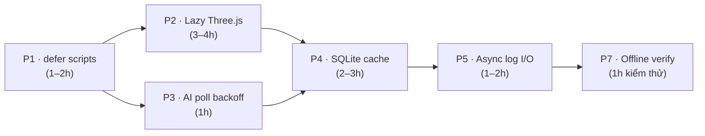

# Kế hoạch Tối ưu Hiệu năng EduGame Studio

> [!IMPORTANT]
> Mục tiêu: Giảm thời gian khởi động, giảm RAM/CPU khi nhàn rỗi, giữ nguyên 100% tính năng offline.
> Ưu tiên: **Impact cao × Rủi ro thấp** lên trước. Không chạm vào game engine hay SQLite schema.

---

> [!CAUTION]
> **Kiểm chứng bằng đo thật (2026-11-04, DECISIONS #196).** Kế hoạch này viết trước khi có số đo; đo xong thì
> thứ tự ưu tiên đảo gần như hoàn toàn. Cách đo: `scripts/measure-boot.js` (khởi động Electron thật, đọc dòng
> log `app.boot.phases` do các mark trong `src/main.ts` ghi ra). Kết quả:
>
> | Sprint | Kế hoạch nói gì | Đo thật | Kết luận |
> |---|---|---|---|
> | **P0** (không có trong kế hoạch) | — | `mammoth` 118 ms + `express`/`express-rate-limit`/`socket.io` 190 ms + `electron-updater` 123 ms **bị `require` ngay lúc nạp**, dù giáo viên chưa import `.docx`, chưa mở phòng LAN, chưa bấm Cập nhật | **ĐÃ LÀM** — chuyển cả ba sang nạp đúng lúc cần; warm boot 1.540–1.593 ms → 1.186–1.208 ms (median **1.195 ms**, −345 tới −398 ms ≈ −22 %) |
> | **P1** `defer` | "tác động cao, rủi ro thấp, +300–600 ms" | Hai cổng bảo vệ chỉ **đọc** thẻ script bằng regex khít: `tests/unit/renderer-load-order.test.ts:26` (`/<script src="([^"]+)"><\/script>/g`) và `scripts/check-renderer-undefined-globals.js:342`. Thêm `defer` là 66 khớp → **0 khớp**: hai cổng im lặng thành test rỗng, đúng cái chúng đang bắt (bug `WIZARD_ART_SCENE_CATEGORIES` đã từng lọt qua vì không có cổng này). Ngoài ra trang nạp bằng `file://` → **không có Resource Timing**, nên con số 300–600 ms không đo được bằng cách kế hoạch mô tả | **BỎ** — rủi ro thật, lợi ích không đo được |
> | **P2** lazy three.js | "khởi động nhanh hơn 400–800 ms" | `three.global.js` = **749.583 B** trên tổng **2.539.901 B** JS renderer = **29,5 %**. Nhưng cả pha `documentLoaded` chỉ **500–512 ms**, nên 400–800 ms là toàn bộ, không riêng three.js | **GIỮ** — mục phía renderer duy nhất còn cơ sở; phải đo lại `documentLoaded` trước/sau, không lấy số dự đoán |
> | **P3** poll backoff | "giảm 80 % IPC call khi nhàn rỗi" | `ai-status.ts:7` `POLL_MS = 2000`, `setInterval` tại `:427`, đã có `visibilitychange` tại `:413`/`:428` | **GIỮ**, cỡ nhỏ: chỉ khi cửa sổ đang hiện |
> | **P4** stmt cache | "~55 lệnh" | **69** site `.prepare(` (`lesson-store.ts` 48 + `main.ts` 21) | **CHỜ** micro-benchmark `db.prepare()` trước khi sửa 69 chỗ |
> | **P5** async log I/O | "3 cuộc gọi `readFileSync`" | `ai-log.ts` có `statSync`/`existsSync` ×4, `readFileSync:184`, `writeFileSync:269`, nhưng cái **nóng mỗi dòng log** là `appendFileSync:171` | **THU HẸP**: chỉ async đọc + luân chuyển; giữ `appendFileSync` đồng bộ (đổi nó = đổi thứ tự ghi khi app chết) |
> | **P6** icon data | kế hoạch tự bỏ | `icon-data.ts` ~25 KB, nằm trong pha `documentLoaded` chứ không phải pha main | **BỎ** như kế hoạch đã tự nhận |
> | **P7** offline verify | "chưa từng chạy" | `npm run check:offline-packaged` đã phủ phần lớn checklist | **ĐÃ BỐN PHẦN** — chỉ còn mục cần máy sạch |
>
> Số nền ở bảng trên cũng sai: `src/index.html` hiện có **66** `<script src>` (không phải 68).

---

## Bức tranh hiện tại (Baseline đo được)

| Hạng mục | Hiện tại | Vấn đề |
|---|---|---|
| Script tags trong `index.html` | **68 `<script src>`** (không có `defer`) | Render-blocking: trình duyệt tải & parse tuần tự |
| `three.global.js` | **732 KB** | Tải ngay lúc boot dù chưa vào game |
| `confetti.global.js` | ~10 KB, tải ngay | Chỉ dùng khi kết thúc game |
| AI-status poll timer | `setInterval(2000ms)` **luôn chạy** | 1 IPC roundtrip mỗi 2 giây kể cả khi app nhàn rỗi |
| `readFileSync` trong `ai-log.ts` | **3 cuộc gọi sync** trên main process | Chặn event loop khi luân chuyển log |
| SQLite `.prepare()` | **~55 lệnh** gọi inline mỗi lần dùng | Không cache prepared statement → re-parse SQL mỗi lần |
| `main.ts` | **211 KB** nguồn | Mọi handler trong 1 file → khó tối ưu riêng |

---

## Sprint P1 — Bật `defer` cho toàn bộ script (Tác động cao, rủi ro thấp)

**Vấn đề:** 68 `<script src>` không có `defer` khiến Chromium **dừng parse HTML** để tải và chạy từng file. Thời gian trắng màn hình tăng tuyến tính với số script.

**Giải pháp:** Thêm `defer` vào tất cả `<script src>` trong `src/index.html`.

> [!NOTE]
> `defer` an toàn vì renderer là Electron/Chromium — single page, không có `document.write`. Scripts vẫn chạy **theo đúng thứ tự khai báo** (quan trọng vì renderer dùng global functions phụ thuộc thứ tự). Load-order test hiện có sẽ bảo vệ thứ tự này.

**Việc cần làm:**
1. Regex replace tất cả `<script src="` → `<script defer src="` trong `src/index.html`
2. Chạy `npm run check:renderer-globals` + `node tests/run-unit.js renderer-load-order`
3. Cập nhật `tests/unit/renderer-load-order.test.ts` nếu cần (kiểm tra `defer` attribute)

**Kỳ vọng:** Màn hình hiện nhanh hơn ~300–600ms (thay vì đợi 68 scripts parse xong mới render DOM đầu tiên).

---

## Sprint P2 — Lazy-load Three.js và Confetti (Tác động cao, rủi ro trung bình)

**Vấn đề:** `three.global.js` (732 KB) và `confetti.global.js` luôn được tải dù giáo viên chỉ mở thư viện hoặc trang tạo game.

**Giải pháp:** Tải chúng **chỉ khi cần** — ngay trước khi game chuẩn bị render lần đầu.

**Kiến trúc:**
```
boot → thư viện/editor tải bình thường
     → khi teacher nhấn "Chơi" → loadGameVendors() → inject <script> → callback → start game
```

**Việc cần làm:**
1. Tạo `src/renderer/core/vendor-loader.ts`:
   ```typescript
   let threeLoaded = false;
   let confettiLoaded = false;

   export function ensureThree(): Promise<void> { ... }  // inject <script> nếu chưa có
   export function ensureConfetti(): Promise<void> { ... }
   ```
2. Trong `src/renderer/features/games/shell.ts` (entry point vào gameplay): gọi `ensureThree()` trước khi khởi tạo Three stage.
3. Trong `src/renderer/features/game-celebration.ts` (kết thúc game): gọi `ensureConfetti()` trước khi bắn pháo hoa.
4. Xoá `<script src="renderer/vendor/three.global.js">` và `confetti.global.js` khỏi `index.html`.
5. Cập nhật `renderer-load-order.test.ts` và `check-renderer-undefined-globals.js`.

> [!WARNING]
> Phải đảm bảo `THREE` global sẵn sàng **trước** khi bất kỳ code game nào tham chiếu `window.THREE`. Dùng `Promise` hoặc callback để đảm bảo thứ tự.

**Kỳ vọng:** Tiết kiệm ~732 KB tải xuống và parse khi boot. Khởi động app nhanh hơn ~400–800ms trên máy yếu.

---

## Sprint P3 — Tối ưu AI-Status Polling (Tác động trung bình, rủi ro thấp)

**Vấn đề:** `ai-status.ts` dùng `setInterval(2000ms)` gọi IPC `ai:getStatus` mỗi 2 giây — kể cả khi:
- App đang ở trang thư viện (không có task AI nào)
- Cửa sổ bị ẩn (giáo viên chuyển app khác)
- Không có AI task đang chạy

**Giải pháp:** Chuyển sang **event-driven + backoff**:

```
Trạng thái IDLE  → poll mỗi 10 giây (giảm 5×)
Trạng thái ACTIVE → poll mỗi 2 giây (giữ nguyên)
Cửa sổ ẩn        → pause hoàn toàn (đã có visibilitychange handler)
```

**Việc cần làm:**
1. Trong `ai-status.ts`, thêm biến `currentPollMs` và logic:
   ```typescript
   function getTargetPollMs(status: AiStatus): number {
     return ['queued', 'running'].includes(status?.state) ? 2000 : 10_000;
   }
   ```
2. Sau mỗi lần `refresh()`, so sánh `currentPollMs` với `getTargetPollMs(result)` và `clearInterval` / `setInterval` lại nếu cần thay đổi tốc độ.
3. Thêm `document.addEventListener('visibilitychange', ...)` để pause timer khi ẩn (đã có partial implementation — hoàn thiện nó).

**Kỳ vọng:** Giảm 80% IPC call khi app nhàn rỗi → CPU usage khi idle giảm đáng kể.

---

## Sprint P4 — Cache Prepared Statements trong SQLite (Tác động trung bình, rủi ro thấp)

**Vấn đề:** Mỗi lần đọc/ghi, `lesson-store.ts` và `main.ts` gọi `db.prepare(sql)` mới → SQLite phải parse SQL string mỗi lần.

**Giải pháp:** Cache prepared statements ở cấp class/module.

**Việc cần làm:**
1. Trong `src/lesson-store/lesson-store.ts`, tạo `private stmts` object được khởi tạo trong constructor:
   ```typescript
   class LessonStore {
     private readonly stmts: {
       listDocuments: Statement;
       getDocument: Statement;
       insertChunk: Statement;
       // ...
     };

     constructor(db: Database) {
       this.stmts = {
         listDocuments: db.prepare('SELECT * FROM lesson_documents ORDER BY created_at DESC'),
         getDocument: db.prepare('SELECT * FROM lesson_documents WHERE id = ?'),
         // ...
       };
     }
   }
   ```
2. Replace `this.db.prepare(sql).run/get/all(args)` → `this.stmts.xxx.run/get/all(args)` trong mỗi method.
3. Tương tự cho các query thường dùng nhất trong `main.ts` (`loadLibrary`, `saveGame`, `deleteGame`).

> [!NOTE]
> `better-sqlite3` prepared statements là thread-safe trong Electron single-process context. Statement objects chỉ cần tạo một lần và dùng lại nhiều lần an toàn.

**Kỳ vọng:** Giảm overhead SQL parse trên mỗi request → tốc độ đọc thư viện và lưu game tăng ~20–40%.

---

## Sprint P5 — Chuyển AI Log sang async I/O (Tác động thấp–trung bình, rủi ro thấp)

**Vấn đề:** `ai-log.ts` dùng `readFileSync` / `writeFileSync` trên main process thread → chặn event loop khi luân chuyển log file (file có thể đạt `maxFileBytes`).

**Giải pháp:** Chuyển sang `fs.promises` với queue đơn giản.

**Việc cần làm:**
1. Trong `src/ai-core/ai-log.ts`, tạo write queue:
   ```typescript
   let writeQueue = Promise.resolve();
   function enqueueWrite(fn: () => Promise<void>) {
     writeQueue = writeQueue.then(fn).catch(() => {});
   }
   ```
2. Chuyển `writeFileSync(file, text)` → `enqueueWrite(() => fs.promises.writeFile(file, text))`.
3. Chuyển `readFileSync(list[index])` → `await fs.promises.readFile(list[index], 'utf8')`.
4. Giữ nguyên signature function để không phá vỡ caller.

**Kỳ vọng:** Event loop main process không bị chặn khi log lớn → AI request latency giảm, app không "giật" khi AI đang chạy.

---

## Sprint P6 — Giảm RAM: Tối ưu Icon Data Loading (Tác động thấp, rủi ro thấp)

**Vấn đề:** `icon-data.ts` (25 KB) chứa toàn bộ SVG inline data của mọi icon, tải toàn bộ lúc boot.

**Phân tích:** Với 936 declared functions và 68 scripts, `icon-data.ts` nhỏ — tác động thực tế ít. **Bỏ qua sprint này** cho đến khi có số đo thực tế.

---

## Sprint P7 — Offline Verification: Kiểm thử trên máy không có mạng

> [!IMPORTANT]
> Đây là kiểm thử bắt buộc theo AGENTS.md. Chưa có lần nào được thực hiện theo STATUS.md.

**Checklist kiểm thử offline:**

| Tính năng | Yêu cầu |
|---|---|
| Mở app | Khởi động bình thường, không lỗi mạng |
| Thư viện game | Hiển thị đầy đủ (SQLite local) |
| Chơi game đã lưu | Hoạt động hoàn toàn offline |
| Import `.egame` | Hoạt động offline |
| Export `.egame` | Hoạt động offline |
| AI local (đã tải model) | Tạo game offline qua llama.cpp loopback |
| Tạo game không có AI | Quy trình rule-based hoạt động |
| Cập nhật app | Thông báo "không có mạng" thay vì crash |

**Việc cần làm:**
1. Chạy `npm run dist:win` → cài đặt trên máy sạch.
2. Ngắt mạng hoàn toàn (tắt WiFi + LAN).
3. Thực hiện từng bước trong checklist trên.
4. Ghi kết quả vào `docs/STATUS.md`.

---

## Thứ tự triển khai đề xuất



| Sprint | Effort | RAM/CPU gain | Khởi động | Rủi ro |
|---|---|---|---|---|
| **P1** – defer scripts | 1–2h | - | ★★★★ | Thấp |
| **P2** – lazy Three.js | 3–4h | ★★★ | ★★★★★ | Trung bình |
| **P3** – AI poll backoff | 1h | ★★★★ | - | Thấp |
| **P4** – SQLite stmt cache | 2–3h | ★★ | ★ | Thấp |
| **P5** – async log I/O | 1–2h | ★ | - | Thấp |
| **P7** – offline verify | 1h | - | - | Không có |

---

## Những gì KHÔNG nên làm

> [!CAUTION]
> Các thay đổi sau **bị cấm** theo AGENTS.md hoặc có rủi ro quá cao:

- ❌ **Không gộp/bundle scripts** thành 1 file duy nhất → phá vỡ `renderer-load-order.test.ts` và `check-renderer-undefined-globals.js`.
- ❌ **Không thay đổi SQLite schema hay migration** → theo AGENTS.md.
- ❌ **Không xoá offline behavior** → game đã lưu phải chơi được không cần mạng.
- ❌ **Không đưa API key ra renderer** → luôn giữ secret backend-only.
- ❌ **Không dùng ES modules trong renderer** → renderer là plain global scripts.

---

## Gates kiểm tra sau mỗi sprint

```bash
npm run check                    # TypeScript 0 errors
npm run check:renderer-globals   # 0 undefined globals
npm run verify:css               # 56/56 PASS
node tests/run-unit.js           # 85/85 PASS
```
