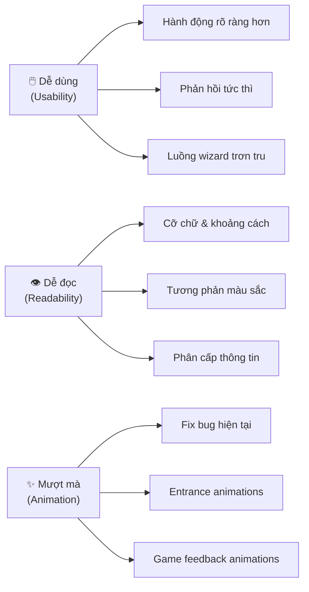

# Kế hoạch cải thiện UI/UX — EduGame Studio
*3 mục tiêu: Dễ dùng · Dễ đọc · Hiệu ứng mượt mà*

---

## Bản đồ 3 mục tiêu



---

## Sprint 1 — Fix ngay (không rủi ro, 1 ngày)

> [!CAUTION]
> Làm sprint này trước — đây là bug làm animation không chạy đúng.

### S1-1 · Fix `answer-celebrate` bị comment sai
**Mục tiêu:** Dễ dùng + Mượt mà  
**File:** `src/renderer/styles/game-animations.css`  
**Vấn đề:** Dấu `/*` nằm giữa dòng `100%` → trình duyệt không parse được `@keyframes`. Thẻ đúng hiện không có animation celebrate nào thực sự chạy — giáo viên/học sinh không biết câu đúng hay sai.  
**Kết quả mong đợi:** Thẻ đúng bùng lên xanh lá + phóng to nhẹ, thẻ sai rung lắc ngang.

---

### S1-2 · Page transition nhìn thấy được
**Mục tiêu:** Mượt mà  
**File:** `src/renderer/styles/base.css`  
**Vấn đề:** Hiện fade từ `opacity: 0.88 → 1` — 12% opacity thay đổi, mắt người không nhìn ra. Chuyển trang cảm giác bị giật.  
**Sửa:** `opacity: 0 → 1` + `translateY: 10px → 0` + duration `0.22s`  
**Kết quả mong đợi:** Mỗi lần chuyển trang (thư viện → tạo game → cài đặt) có slide-up nhẹ, cảm giác ứng dụng đang "mở trang mới" thay vì nhảy.

---

### S1-3 · Toast tắt mượt (không biến mất đột ngột)
**Mục tiêu:** Mượt mà  
**File:** `src/renderer/styles/components.css` + JS nơi gọi `toast()`  
**Vấn đề:** Hiện JS xóa class `.show` → toast biến mất tức thì (không có exit animation) vì DOM bị xóa trước khi CSS transition kịp chạy.  
**Sửa:** Giữ element thêm 220ms trong DOM sau khi tắt `.show` → CSS transition tự fade-out.  
**Kết quả mong đợi:** Toast trượt xuống mờ dần thay vì "bẻ gãy".

---

## Sprint 2 — Dễ đọc hơn (2 ngày)

> [!NOTE]
> Các thay đổi chỉ CSS, không đụng JS. Chạy `npm run verify:css` sau mỗi nhóm.

### S2-1 · Tăng cỡ chữ tiêu đề trang
**Mục tiêu:** Dễ đọc  
**File:** `src/renderer/styles/components.css`  
**Vấn đề:** `.page-head h1` hiện `font-size: 17px` — cùng cỡ với nội dung thẻ. Tiêu đề "Thư viện trò chơi", "Tạo trò chơi" không tạo được phân cấp rõ.  
**Sửa:** `17px → 20px`, `font-weight: 700 → 800`, thêm `letter-spacing: -0.4px`  
**Kết quả mong đợi:** Nhìn vào là biết đang ở trang nào, không cần đọc từng chữ.

---

### S2-2 · Khoảng cách trong feedback panel rộng hơn
**Mục tiêu:** Dễ đọc  
**File:** `src/renderer/styles/navigation.css`  
**Vấn đề:** `.feedback` có `padding: 13px 15px` và `line-height: 1.65` — hơi chật khi trình chiếu trên màn lớn, giáo viên đứng xa khó đọc giải thích.  
**Sửa:** `padding: 16px 20px`, `line-height: 1.75`, `font-size` tối thiểu tăng 1px  
**Kết quả mong đợi:** Phần giải thích sau khi trả lời đọc thoải mái từ phía sau lớp.

---

### S2-3 · Node kho báu hiện tại nổi bật hơn
**Mục tiêu:** Dễ đọc + Dễ dùng  
**File:** `src/renderer/styles/components.css`  
**Vấn đề:** `treasurePulse` chỉ scale `1 → 1.06` — 6% thay đổi quá nhỏ. Học sinh nhỏ tuổi nhìn bản đồ không biết đang ở chặng nào.  
**Sửa:** Scale `1 → 1.14` + thêm `box-shadow` pulse: `0 0 0 8px rgba(98,88,232,0.25) → 0 0 0 0`  
**Kết quả mong đợi:** Node đang chơi có "nhịp tim" nhìn thấy được từ xa.

---

### S2-4 · Nút "Trình chiếu" (`.play-tool-present`) dễ nhận ra hơn
**Mục tiêu:** Dễ dùng  
**File:** `src/renderer/styles/gameplay.css`  
**Vấn đề:** Nút trình chiếu và các nút khác (LAN, đóng) trông gần như nhau về kích thước. Giáo viên mới dùng lần đầu không biết bấm đâu để chiếu.  
**Sửa:** Tăng `min-height` từ `38px → 44px`, `padding: 0 20px`, thêm text label "Trình chiếu" to hơn `14px → 15px`, giữ nguyên gradient tím.  
**Kết quả mong đợi:** Nút chính lớn hơn hẳn so với các nút phụ — nhìn vào biết ngay "cái này quan trọng".

---

### S2-5 · Match-card selected rõ hơn khi chọn trong ghép cặp
**Mục tiêu:** Dễ đọc + Dễ dùng  
**File:** `src/renderer/styles/game-animations.css`  
**Vấn đề:** `.match-card.selected` dùng `transform: scale(1.02)` — 2% phóng to, học sinh không nhận ra thẻ đã được chọn.  
**Sửa:** `scale(1.02) → scale(1.05)`, tăng `box-shadow` lên rõ hơn, thêm `border-width: 2px → 3px`  
**Kết quả mong đợi:** Học sinh biết ngay thẻ nào đang "cầm trong tay".

---

### S2-6 · Phân biệt rõ `.btn-primary` vs `.btn-secondary` trong editor
**Mục tiêu:** Dễ dùng  
**File:** `src/renderer/styles/components.css`  
**Vấn đề:** Trong trình soạn thảo có nhiều nút (Lưu, Thêm câu, Tạo lại bằng AI, Huỷ) nhưng tất cả cùng cỡ `btn-small`. Giáo viên hay bấm nhầm.  
**Sửa:** `.btn-primary.btn-small` tăng padding ngang `10px → 14px`, thêm icon gap rõ hơn. `.btn-secondary.btn-small` giữ nguyên để tạo tương phản kích thước.  
**Kết quả mong đợi:** Nút chính trong editor nổi bật so với nút phụ.

---

## Sprint 3 — Hiệu ứng gameplay mượt mà (2 ngày)

> [!IMPORTANT]
> Mỗi animation phải có `prefers-reduced-motion: reduce` tương ứng. Không thêm animation mới mà không có fallback.

### S3-1 · Animation câu hỏi tiếp theo reset đúng
**Mục tiêu:** Mượt mà  
**File:** `src/renderer/features/games/quiz.ts`  
**Vấn đề:** `renderQuestion()` cập nhật `innerHTML` trong cùng element cũ → CSS animation `question-slide-in` chỉ chạy 1 lần đầu, các câu sau xuất hiện đột ngột.  
**Sửa:** 3 dòng JS trước khi inject HTML mới:
```js
el.classList.remove('q-enter');
void el.offsetWidth; // force reflow
el.classList.add('q-enter');
```
**Kết quả mong đợi:** Mỗi câu hỏi mới trượt vào từ phải, học sinh nhận ra "câu mới bắt đầu".

---

### S3-2 · Memory card flip 3D thực sự
**Mục tiêu:** Mượt mà  
**File:** `src/renderer/styles/game-animations.css`  
**Vấn đề:** Hiện chỉ `rotateY(90deg → 0deg)` — thẻ trượt ra từ cạnh chứ không "lật". Không có cảm giác "mặt sau thẻ được tiết lộ".  
**Sửa:** Thêm `perspective(600px)` vào keyframe + pha overshoot nhẹ (scale 1.04 ở 55%) rồi về 1.0  
**Kết quả mong đợi:** Thẻ bộ nhớ lật như thẻ bài thật — học sinh thấy "bài đang được lật".

---

### S3-3 · Thẻ ghép đúng có flash xanh lá
**Mục tiêu:** Mượt mà + Dễ dùng  
**File:** `src/renderer/styles/game-animations.css`  
**Vấn đề:** Khi ghép đúng, thẻ chỉ fade opacity về 0.72 ngay lập tức — không có cảm giác "thành công".  
**Sửa:** Thêm `@keyframes match-pair-done`: scale lên 1.05 + box-shadow xanh lá bùng ra rồi tắt trong 320ms  
**Kết quả mong đợi:** Mỗi cặp ghép đúng có "bùng sáng" xanh lá — học sinh biết ngay mình vừa làm đúng.

---

### S3-4 · Điểm chip đội "đếm lên" khi nhận điểm
**Mục tiêu:** Mượt mà + Dễ dùng  
**File:** `src/renderer/features/games/quiz.ts` hoặc `result-screen.ts`  
**Vấn đề:** Điểm đội nhảy từ số cũ sang số mới ngay lập tức. Giáo viên không biết đội nào vừa được thêm điểm.  
**Sửa:** `requestAnimationFrame` đếm từ giá trị cũ → mới trong 350ms (hàm đơn giản, không cần thư viện)  
**Kết quả mong đợi:** Điểm đếm lên trước mắt → học sinh hào hứng theo dõi bảng điểm.

---

### S3-5 · Màn kết quả có entrance animation cho từng dòng
**Mục tiêu:** Mượt mà  
**File:** `src/renderer/styles/game-animations.css` + `result-screen.ts`  
**Vấn đề:** Màn kết quả xuất hiện đầy đủ ngay lập tức — tất cả thông tin đổ ra cùng lúc, giáo viên không có thời gian "reveal" từng phần cho cả lớp.  
**Sửa:** Các dòng kết quả có `animation-delay: calc(var(--i) * 80ms)` — xuất hiện lần lượt từ trên xuống  
**Kết quả mong đợi:** "🏆 Xuất sắc!" → điểm → số câu đúng → hiện lần lượt như game show.

---

## Sprint 4 — Dễ dùng nâng cao (3 ngày)

### S4-1 · Staggered entrance cho thẻ thư viện
**Mục tiêu:** Mượt mà + Dễ dùng  
**File:** `src/renderer/styles/components.css` + `src/renderer/pages/library.ts`  
**Vấn đề:** 9 thẻ trò chơi xuất hiện cùng lúc → trang "bật ra" thay vì "được tải".  
**Sửa:** Mỗi `.game-card` nhận `style="--i: N"` trong `libraryCardHtml()` → CSS áp `animation-delay: calc(var(--i) * 55ms)` + `animation: card-enter 0.28s`  
**Kết quả mong đợi:** Thẻ xuất hiện theo sóng từ trái sang phải — thư viện trông sống động, không "bật cứng".

---

### S4-2 · Wizard step chuyển bước có direction animation
**Mục tiêu:** Mượt mà + Dễ dùng  
**File:** `src/renderer/styles/wizard.css` + `src/renderer/pages/create-wizard.ts`  
**Vấn đề:** Chuyển bước wizard (Nhập liệu → Phân tích → Gợi ý…) nội dung thay thế đột ngột. Giáo viên không biết đang tiến hay lùi.  
**Sửa:** JS lưu hướng (tiến/lùi) → thêm class `step-forward` hoặc `step-back` → CSS slide tương ứng (tiến: slide từ phải; lùi: slide từ trái)  
**Kết quả mong đợi:** Wizard cảm giác như "đi qua các bước" thay vì "bấm nút đổi nội dung".

---

### S4-3 · Thanh tìm kiếm thư viện có focus ring rõ
**Mục tiêu:** Dễ dùng  
**File:** `src/renderer/styles/components.css` hoặc inline trong `library.ts`  
**Vấn đề:** Thanh tìm kiếm `.lib-search input` không có focus state rõ ràng — giáo viên không biết ô có đang active hay không.  
**Sửa:** Khi focus: `border-color: #6258e8` + `box-shadow: 0 0 0 3px #6258e820` + icon tìm kiếm đổi màu tím  
**Kết quả mong đợi:** Rõ ngay khi ô nhập liệu đang hoạt động.

---

### S4-4 · Empty state thư viện có call-to-action rõ ràng hơn
**Mục tiêu:** Dễ dùng  
**File:** `src/renderer/pages/library.ts` + `src/renderer/styles/components.css`  
**Vấn đề:** Khi chưa có trò chơi nào, hiển thị `emptyState(...)` với nút "Tạo trò chơi" trông giống nút phụ. Giáo viên mới không biết bước đầu tiên là gì.  
**Sửa:** Empty state có thêm icon lớn hơn (40px), mô tả 2 lựa chọn rõ ("Tạo từ giáo án" vs "Tạo thủ công"), nút chính to hơn.  
**Kết quả mong đợi:** Giáo viên mới mở app lần đầu biết ngay phải làm gì.

---

### S4-5 · Hover state của `.game-card` rõ hơn
**Mục tiêu:** Dễ dùng + Mượt mà  
**File:** `src/renderer/styles/components.css`  
**Vấn đề:** `.game-card:hover` chỉ tăng `box-shadow` — thẻ không di chuyển. Với spring cubic-bezier đã có sẵn, bỏ phí cơ hội tạo cảm giác "thẻ có thể nhấc lên".  
**Sửa:** Thêm `transform: translateY(-3px)` vào hover. Spring bezier đã đúng.  
**Kết quả mong đợi:** Thẻ trò chơi "nổi lên" khi di chuột — rõ ràng có thể bấm.

---

### S4-6 · `.nav-item.active` indicator slide mượt hơn
**Mục tiêu:** Mượt mà  
**File:** `src/renderer/styles/navigation.css`  
**Vấn đề:** Thanh dọc bên trái nav (`:before`) có transition `0.22s` nhưng khi chuyển trang nhanh thì nó bị "nhảy" vì trang mới render lại toàn bộ `.nav-item`. Cảm giác giật.  
**Sửa:** Giữ nguyên transition, nhưng thêm `will-change: transform` trên `.nav-item::before` để GPU chuẩn bị sẵn.  
**Kết quả mong đợi:** Thanh indicator trượt mượt hơn, không giật khi chuyển trang nhanh.

---

## Bảng tóm tắt

| Sprint | Nhiệm vụ | File CSS | File JS | Rủi ro | Thời gian |
|---|---|---|---|---|---|
| **S1** | S1-1 Fix celebrate bug | `game-animations.css` | — | 🟢 Thấp | 15 phút |
| **S1** | S1-2 Page transition | `base.css` | — | 🟢 Thấp | 10 phút |
| **S1** | S1-3 Toast exit | `components.css` | toast JS | 🟢 Thấp | 20 phút |
| **S2** | S2-1 Tiêu đề trang | `components.css` | — | 🟢 Thấp | 10 phút |
| **S2** | S2-2 Feedback padding | `navigation.css` | — | 🟢 Thấp | 10 phút |
| **S2** | S2-3 Treasure pulse | `components.css` | — | 🟢 Thấp | 10 phút |
| **S2** | S2-4 Nút trình chiếu | `gameplay.css` | — | 🟢 Thấp | 15 phút |
| **S2** | S2-5 Card selected | `game-animations.css` | — | 🟢 Thấp | 10 phút |
| **S2** | S2-6 Nút primary/secondary | `components.css` | — | 🟢 Thấp | 15 phút |
| **S3** | S3-1 Question slide reset | — | `quiz.ts` | 🟡 Trung bình | 30 phút |
| **S3** | S3-2 Memory flip 3D | `game-animations.css` | — | 🟢 Thấp | 20 phút |
| **S3** | S3-3 Match pair flash | `game-animations.css` | — | 🟢 Thấp | 20 phút |
| **S3** | S3-4 Điểm đếm lên | — | `quiz.ts` | 🟡 Trung bình | 45 phút |
| **S3** | S3-5 Màn kết quả cascade | `game-animations.css` | `result-screen.ts` | 🟡 Trung bình | 30 phút |
| **S4** | S4-1 Card stagger | `components.css` | `library.ts` | 🟡 Trung bình | 45 phút |
| **S4** | S4-2 Wizard direction | `wizard.css` | `create-wizard.ts` | 🟡 Trung bình | 60 phút |
| **S4** | S4-3 Search focus ring | `components.css` | — | 🟢 Thấp | 15 phút |
| **S4** | S4-4 Empty state CTA | `components.css` | `library.ts` | 🟢 Thấp | 30 phút |
| **S4** | S4-5 Card hover lift | `components.css` | — | 🟢 Thấp | 5 phút |
| **S4** | S4-6 Nav indicator GPU | `navigation.css` | — | 🟢 Thấp | 5 phút |

> [!TIP]
> Sprint 1 có thể làm trong 1 tiếng. Sprint 2 trong 1 buổi. Mỗi sprint có thể chạy độc lập — làm xong sprint nào, `npm run verify:css` + `npm run check:renderer-globals` ngay sprint đó.

> [!IMPORTANT]
> Mọi animation mới phải có `@media (prefers-reduced-motion: reduce)` tắt hoặc giảm xuống. Đây là yêu cầu bắt buộc theo thiết kế hiện tại của dự án.
